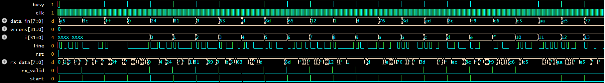

# UART Transmitter & Receiver in Verilog

FSM-based 8N1 UART (start bit, 8 data bits LSB first, stop bit) with a self-checking loopback testbench.

## Files
- `uart_tx.v` – transmitter (IDLE → START → DATA → STOP FSM)
- `uart_rx.v` – receiver with 2-flop input synchronizer and mid-bit sampling
- `tb_uart.v` – loopback testbench: 4 directed bytes + 20 random bytes, PASS/FAIL checking

## Run
```
iverilog -o sim uart_tx.v uart_rx.v tb_uart.v
vvp sim
```
Expected output ends with `ALL TESTS PASSED`. Also run on EDA Playground: <your link>.

## Waveform


## Parameters
`CLKS_PER_BIT` = clock cycles per UART bit (clock frequency / baud rate).

## Possible extensions
Parity bit, baud-rate generator, FIFO buffering, FPGA implementation.
